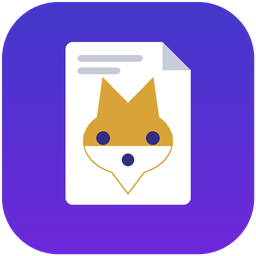
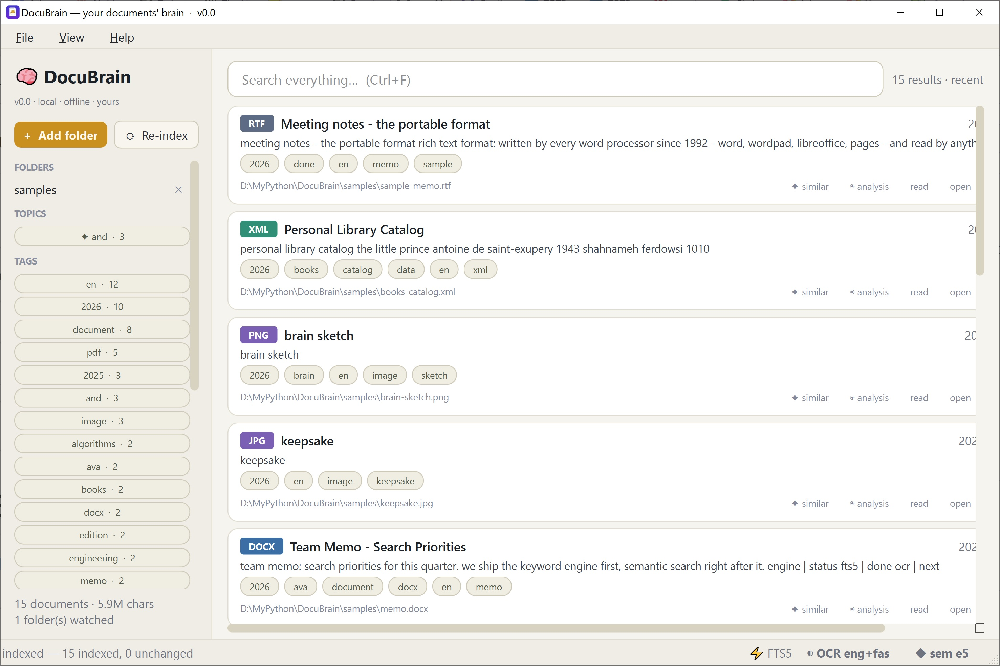
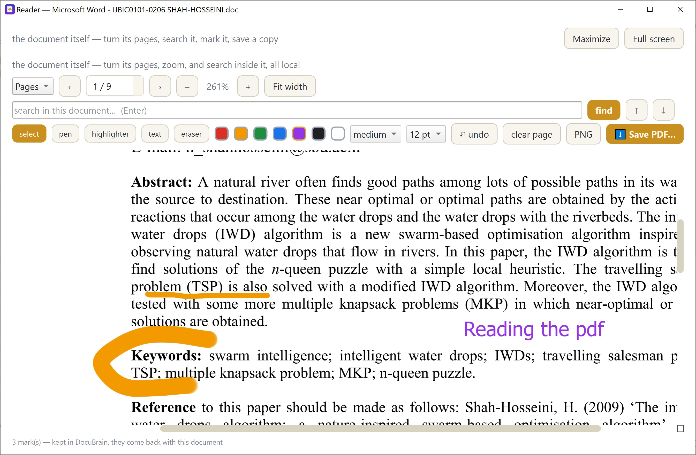

# DocuBrain v0.0

  
  <h1>DocuBrain</h1>
  
<em>Your documents' brain. Local. Offline. Yours.</em>

---

DocuBrain, first release. Point it at your folders — DocuBrain reads **txt, pdf, docx, rtf, html, xml
and images**, indexes every word, tags documents automatically and answers
instant search. **Nothing leaves your machine:** no cloud, no account, no
network.

## ⬇️ Download

Get **DocuBrain.exe** from the [**Releases**](https://github.com/ostad-ai/DocuBrain/releases/tag/v0.0).

1. Put the exe in its own folder — that folder is DocuBrain's whole life.
2. Optional, next to the exe: a `models/` folder (local semantic search) and
   a `tesseract/` folder (OCR for scans and photos). Without them DocuBrain
   still runs — and tells you so honestly.
3. The first start unpacks for 10–30 seconds; the fox on the splash is
   watching the wait with you.
4. SmartScreen may warn (the exe is unsigned): **More info → Run anyway**.

Windows 10 or newer, 64-bit. Nothing is installed — delete the folder and DocuBrain is gone.

## What it does

- **Instant search** — every word of every document, the moment you type
- **Automatic tags, concepts, topics** — the index understands your library
- **Semantic search** — find by meaning, not just words; the model runs on
  your machine
- **OCR** — scanned PDFs and photos of text become searchable; Persian (fas)
  supported
- **Reader with annotations** — pen, highlighter, text notes; burn them into
  a real PDF copy
- **Topic maps** — see what a whole book is about, at a glance
- **فارسی** — the whole interface speaks Persian too
- **Portable & private** — one folder, no installer, no telemetry

## ⭐ If you like it

If DocuBrain found your documents, tap the **Star** button at the top of
this page. It costs nothing, helps other people discover DocuBrain — and
keeps the fox motivated to guard your library.

اگر DocuBrain برایتان سودمند بود، همین دیمه را با ⭐ ستاره بدهید — هیچ هزینه‌ای
ندارد، به دیگران یاری می‌کند DocuBrain را پیدا کنند، و روباهِ روی نمادک را
شادمان می‌کند.

## Questions

**Does anything leave my computer?**
No. Fully offline — no account, no telemetry, no network calls.

**Do I need models/ and tesseract/?**
They are optional extras. Search works out of the box; semantic search
needs `models/`, OCR needs `tesseract/` — drop them next to the exe.

**How do I uninstall?**
Delete the folder. That was everything.

---
<table>
<tr>
<td>
 Figure 1. DocuBrain, first release, version 0.0
</td>
<td>
 Figure 2. DocuBrain, reader part, first release, version 0.0
</td>
</tr>
</table>

Built by **Hamed Shah-Hosseini**. 
© Hamed — all rights reserved.